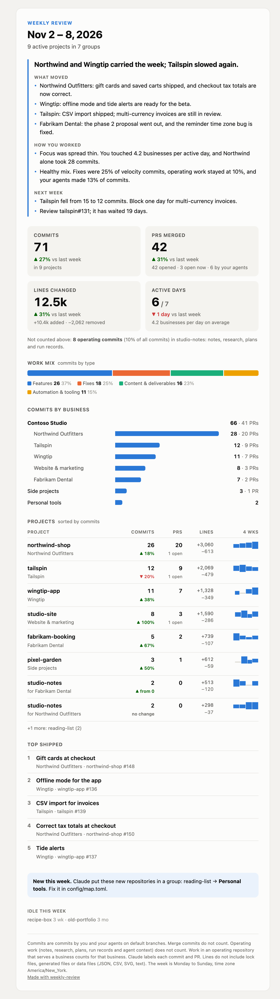
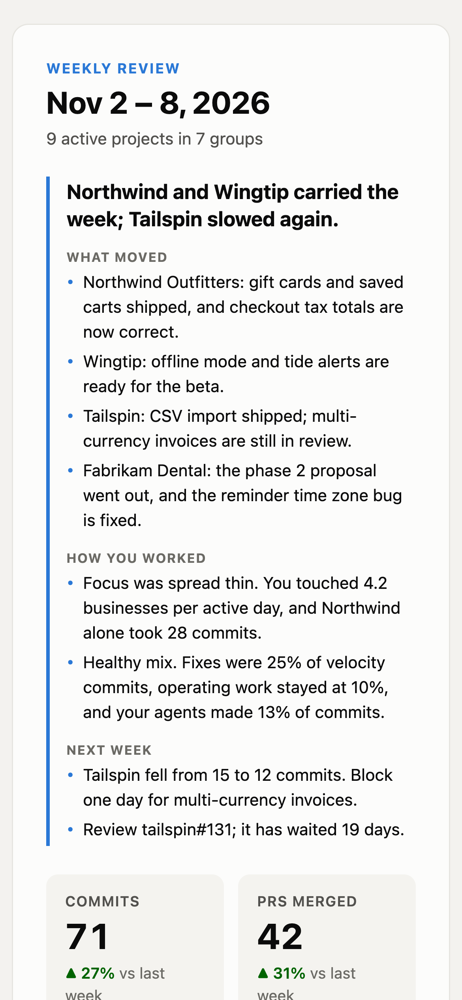

# Weekly review

A weekly email that shows what you shipped on GitHub, grouped by business and project, with a short review of
how the week went. It works as a [Claude Code](https://claude.com/claude-code) skill: install it, ask Claude to
set up your weekly review, and Claude configures, tests and schedules it with you.

<p align="center">
  
  &nbsp;
  
</p>

<sub>The screenshots use made-up demo data with fictional sample brands. Run `python weekly_review.py --home /tmp/wr-demo demo` to make your own.</sub>

## What is in the email

- **An opening review** by Claude: a headline, what moved for each business, how you worked (focus, mix of work,
  PR flow) and one or two actions for next week. If you keep dated priorities files, it compares plan and result.
- **Four key numbers** with the change from last week: commits, PRs merged, lines changed, active days.
- **Work mix**: your commits split into features, fixes, content and deliverables, and automation and tooling.
- **Commits by business**: one bar per group, with sections (for example a company with its clients and products).
- **Projects**: commits, PRs, lines and a 4-week trend for each active repository.
- **Top shipped**: the five most important merged PRs.
- **Idle projects** in small print, so you can see what you have not touched.

It also handles a few things that make simple commit counts misleading:

- **Agents count as you.** Add the identities of your coding agents, bots or GitHub Apps; the email shows their share.
- **An operating base.** A repository where you keep notes, plans and context for your agents does not count as
  velocity. Work in it that serves a business (a client proposal, an article) counts for that business.
- **Fair line counts.** Lock files, generated output and data files do not count.
- **Low upkeep.** Rules place new repositories by owner or name; Claude places the rest and tells you in the email.

## Requirements

- Python 3.11 or later (standard library only; on Windows also `pip install tzdata`)
- The [GitHub CLI](https://cli.github.com) (`gh`), signed in with read access to your repositories
- The [Claude Code](https://claude.com/claude-code) CLI (`claude`), signed in; it labels the work and writes the review
  (turn this off with `summary.enabled = false`)
- A way to send mail: any SMTP account, or your own send command, or no mail at all (HTML file only)

It runs on macOS, Linux and Windows, with any scheduler.

## Install as a Claude Code skill

```bash
git clone https://github.com/jambronner/weekly-review-skill ~/.claude/skills/weekly-review
```

Then ask Claude Code something like *"set up my weekly review"*. The skill guides Claude through it: it checks
the requirements, shows you the demo, finds your repositories and agent identities, proposes a group map for you
to correct, sets up mail and schedules the job for your operating system.

## Use it without Claude Code setup help

```bash
python weekly_review.py init                 # writes config templates to ~/.weekly-review/config
# edit settings.toml and map.toml
python weekly_review.py check                # GitHub, Claude and mail access; sends nothing
python weekly_review.py build                # writes ~/.weekly-review/out/<week>.html
python weekly_review.py send                 # builds and emails it
python weekly_review.py scheduled            # for your scheduler: sends once a week when due
```

`--home DIR` (or `WEEKLY_REVIEW_HOME`) puts your data somewhere else. Your data stays out of the skill folder,
so updating the skill never touches it.

## Documentation

- [Configuration](references/configuration.md): every setting and the project map
- [Mail](references/mail.md): SMTP providers, password sources for each operating system, custom commands
- [Scheduling](references/scheduling.md): launchd, systemd, cron, Windows Task Scheduler and others
- [How it works](references/how-it-works.md): what each number means, work types, attribution and limits

## Privacy

Your data goes only to GitHub (through your `gh` login), to Claude (through your `claude` login) and to your
mail server. The data folder holds commit subjects and PR titles from your private repositories; keep it
private. Passwords are never stored by this tool; it reads them from an environment variable, your OS
keychain or your password manager.

## Development

```bash
python -m unittest discover -s tests -t .
```

## License

MIT. See [LICENSE](LICENSE).
